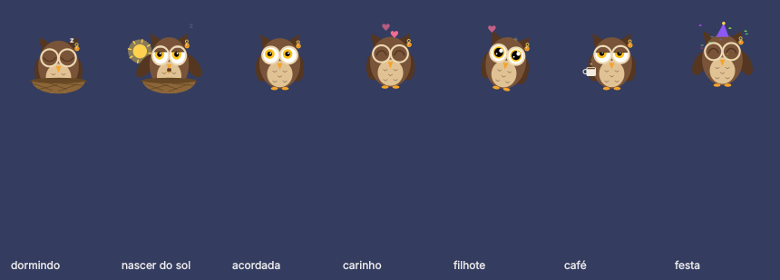

# 🦉 Coruja para Windows

Um amiguinho de mesa que mantém o computador acordado.



- **Olhos abertos**: a tela não apaga, o PC não suspende e você não fica "ausente".
- **Olhos fechados**: tudo volta ao normal.

Ela é pequena, fica num cantinho da tela e tem vida própria: respira, pisca, olha para o
mouse, passeia, toma café, almoça e dorme no ninho.

> Também existe para [macOS](https://github.com/RafaelRJesus/MAC_Coruja) e [Linux](https://github.com/RafaelRJesus/Linux_Coruja).

## Instalação

1. Baixe o **Coruja.exe** na página de [Releases](https://github.com/RafaelRJesus/Windows_Coruja/releases/latest).
2. Dê dois cliques. Não precisa instalar nada (nem o .NET).

Como o app não tem assinatura digital paga, o Windows pode mostrar o aviso
"O Windows protegeu o computador". Clique em **Mais informações → Executar assim mesmo**.

Para abrir junto com o Windows: aperte `Win + R`, digite `shell:startup` e coloque um atalho
do Coruja.exe nessa pasta.

## Como usar

| Ação | O que acontece |
|---|---|
| Clicar nos **olhos** | Acorda / põe a coruja para dormir |
| Clicar na **orelha direita** (a do brinco) | Quando dormir: temporizador ou horário |
| Clicar na **orelha esquerda** | Animações: liga/desliga, opções e tamanho |
| Clicar na **barriga** | Carinho (olhinhos ^^ e corações) |
| Arrastar a coruja | Move pela tela (ela bate as asas) |
| Botão direito ou ícone na bandeja | Menu com tudo isso e "Sair" |

### Quando dormir (orelha direita)

- **Sem limite**: fica acordada até você fechar os olhos dela.
- **Temporizador**: contagem regressiva e depois dorme sozinha.
- **Horário**: dorme num horário fixo (se já passou hoje, vale para amanhã).

A pedra do brinco mostra a opção ativa: **laranja** = sem limite, **azul** = temporizador,
**verde** = horário.

### Animações (orelha esquerda)

- **Sempre**: espreguiça com o nascer do sol ao acordar, se aninha no ninho com o pôr do sol
  ao dormir, bate as asas quando arrastada e fica feliz com carinho.
- **Aleatórias** (sorteadas, sem repetir a anterior): olhar em volta, piar, bater asas,
  pulinho, descansar no ninho, bocejar e passear pela tela.
- **Chamar atenção** (opcional): carinha de filhote de vez em quando.
- **Por horário** (opcional, uma vez por dia num momento sorteado): café (8:30–10h),
  almoço (12–13:30), lanche (15:30–16:30), festa na sexta (17–18h), anoitecer (18:30)
  e amanhecer (6h).

### Leve

Parada, usa de 8 a 12 quadros por segundo; 30 só durante uma animação. Com as animações
desligadas, fica parada e não usa processamento.

## Como ela mantém o computador acordado

- `SetThreadExecutionState` impede que a tela apague e que o PC suspenda.
- A cada 4 minutos envia a tecla **F15** (que não existe no teclado e não faz nada) para
  zerar o tempo ocioso.
- Ao fechar os olhos, devolve o controle de energia ao Windows.

As configurações ficam em `%APPDATA%\Coruja\settings.json`.

## Compilar

Precisa do [.NET 8 SDK](https://dotnet.microsoft.com/download/dotnet/8.0).

```powershell
dotnet run --project src/Coruja                 # roda
dotnet run --project tests/LogicCheck           # confere a lógica (roda em qualquer sistema)
dotnet publish src/Coruja -c Release -r win-x64 --self-contained true -p:PublishSingleFile=true -o out
```

O GitHub Actions compila a cada envio. Criando uma tag `v*`, o `Coruja.exe` é publicado
em Releases.

## Estrutura

```
src/Coruja/
  Logic/          configurações, Pose e motor de animação (C# puro, sem WPF)
  Ui/Draw.cs      desenho da coruja e dos efeitos
  Ui/OwlCanvas.cs elemento que desenha e recebe os cliques
  Ui/Panels.cs    painéis das orelhas
  KeepAwake.cs    mantém o Windows acordado
  CorujaApp.cs    liga tudo (janela, bandeja, timers)
tests/LogicCheck/ verificação da lógica
```

Feito com C# e WPF (.NET 8).
